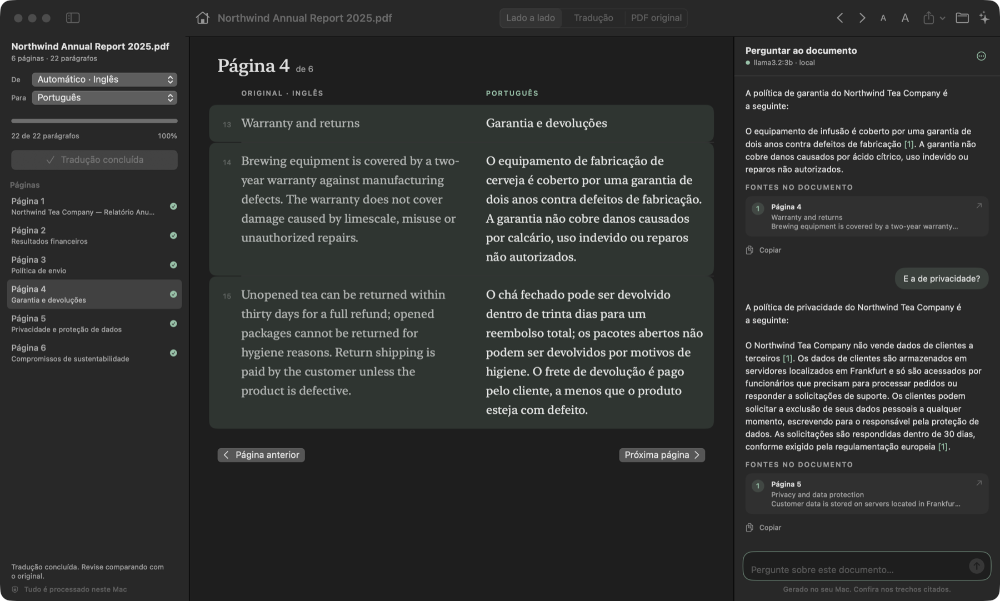
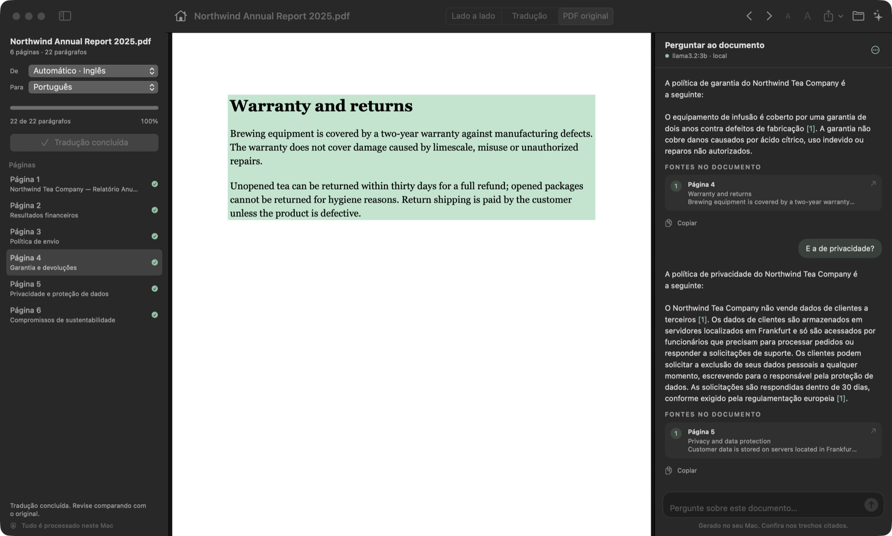

<p align="center">
  
</p>

<h3 align="center">Read a PDF in your language, and ask it questions.</h3>

<p align="center">
  A native Mac app that puts the translation next to the original, paragraph by paragraph,<br>
  and answers questions about the document with a local Llama model that points to the exact passage.<br>
  No account, no cloud, no subscription.
</p>

<p align="center">
  <a href="../../releases/latest"></a>
  <a href="../../releases"></a>
  <a href="https://github.com/Magnumja/Paragrafo/actions/workflows/ci.yml"></a>
  
  
  
  
  <a href="LICENSE"></a>
</p>

<p align="center">
  <a href="../../releases/latest/download/Paragrafo.zip"><b>⬇ Download Parágrafo for Mac</b></a>
  &nbsp;·&nbsp;
  <a href="README.pt-BR.md">Leia em português</a>
</p>

<p align="center">
  
</p>

---

## Why Parágrafo

Translating a PDF usually means losing the original, and asking an AI about it usually means uploading it somewhere. Parágrafo does both on your Mac.

- **The original stays in sight.** Each paragraph sits beside its translation, so a number, a name or a clause can be checked at a glance.
- **Answers that show their source.** Ask in your own language about a document in any language. Answers are instructed to include citations; click it and the app jumps to the passage and marks it, on the real PDF page if you want.
- **A summary you can verify.** One click gives the main points of the whole document, each linked to where it came from.
- **Nothing is lost.** Translation, search index and summary are saved per file. Reopen the PDF and they are there.
- **Light on the Mac.** The app bundle is about 4.1 MB. Optional AI models run separately in Ollama and can use several GB of memory; requests now use a two-minute idle retention policy. See the [resource review](docs/RELEASE-REVIEW.md).

<p align="center">
  
</p>

## Install

1. Download **[Paragrafo.zip](../../releases/latest/download/Paragrafo.zip)**, unzip it and move **Parágrafo** to Applications.
2. The app is not notarized by Apple. The first time, right-click it and choose **Open**, or allow it in **System Settings → Privacy & Security**.
3. For the question panel, install [Ollama](https://ollama.com/download). Parágrafo starts it for you and offers to download the two models it needs (about 3.2 GB, once):

```sh
ollama pull llama3.2:3b
```

```sh
ollama pull bge-m3
```

Reading and translating work without Ollama.

## How to use it

| | |
|---|---|
| **Open a PDF** | ⌘O, drag it into the window, "Open With" in Finder, or pick a recent one |
| **Translate** | Choose the languages in the sidebar and press *Traduzir documento*. It starts on the page you are reading; pause and resume at will |
| **Reading modes** | *Lado a lado* (side by side), *Tradução* (translation only), *PDF original* |
| **Ask** | ⌘K opens the panel. Type a question, or use *Síntese geral* for a summary |
| **Follow a source** | Click a citation or a source card to jump to the passage |
| **Per paragraph** | Hover for copy, "explain this passage" and "show in the PDF" |
| **Pages** | Sidebar, or ⌘[ and ⌘] |
| **Text size** | ⌘+ and ⌘- |
| **Export** | Translated PDF, bilingual Markdown or bilingual text |

The interface is in Brazilian Portuguese.

## How the answers are produced

1. Paragraphs are grouped per page into passages of about 900 characters.
2. Each passage is embedded with `bge-m3` (multilingual, 1024 dimensions) and stored in `~/Library/Application Support/Paragrafo/`.
3. Your question is matched against the passages by vector similarity and by words (BM25, including the translation when there is one). The two rankings are combined, and the best semantic matches always keep a place.
4. The six best passages, numbered, go to the model with the instruction to answer only from them and cite each one.
5. The app turns the citations into links to the source paragraphs.

## Privacy

- PDFs, translations, the search index and in-memory conversations stay on your Mac. Saved work is not application-encrypted; chat history is not persisted.
- Translation uses Apple's Translation framework. macOS may download language packs from Apple the first time a language pair is used.
- Questions go to Ollama on `127.0.0.1:11434`. Ollama downloads models from its registry when you ask it to.
- The app has no account, analytics or telemetry. Its Ollama client rejects non-loopback endpoints, redirects and cloud-backed models. Custom model/server configurations still need care; see [SECURITY.md](SECURITY.md).

See [SECURITY.md](SECURITY.md) for how to report a problem.

## Limits, honestly

- **Translation speed** is that of the system engine, about 0.6 s per paragraph on an M5. Batching and parallel sessions were measured and do not help ([PERF.md](PERF.md)).
- **The default model has 3 billion parameters.** It handles factual questions about the text well, but it can paraphrase loosely or cite the wrong passage. Always check the source it points to. Any larger chat model installed in Ollama can be picked in the panel's menu.
- **Very long documents** are summarized from 24 evenly spread parts, and the app says so when that happens.
- **Extraction** splits paragraphs by spacing, indentation, font size and line order. Columns, tables and vertical text may need review. Scanned pages go through OCR.
- **Languages** are those Apple's Translation framework supports.
- A synthetic 200-page text PDF was profiled; complex scans and very large documents still need testing. See [release review](docs/RELEASE-REVIEW.md).

## Resource budgets

- Release bundle under 50 MiB (enforced in CI; currently about 4.1 MiB).
- Embeddings in bounded batches; output capped at 1,024 tokens.
- AI model memory is separate and can exceed 3 GB with the default pair.
- Run `./benchmark-resources.sh` to profile a synthetic 200-page text PDF.

## Build from source

Requires macOS 15+ and Swift 6 (Xcode 16+ or the Command Line Tools). No third-party dependencies.

```sh
./build-app.sh
```

```sh
open "dist/Parágrafo.app"
```

Checks (they use a temporary folder and never touch saved work):

```sh
./check.sh            # extraction, OCR, persistence, export, answer links
./check-model.sh      # translation session lifecycle
./check-rag.sh        # chunking, hybrid search, Ollama client
./check-assistant.sh  # end to end with a real PDF and a real local model
```

| File | Role |
|---|---|
| `App.swift` | Window, toolbar, wiring between reader and assistant |
| `Sidebar.swift`, `ReaderViews.swift`, `ChatViews.swift`, `PDFPane.swift` | Interface |
| `ReaderModel.swift` | Import, translation, navigation, export |
| `Assistant.swift` | Ollama availability, index, questions, summary |
| `RAG.swift` | Chunking, vector index, hybrid search, prompt |
| `Ollama.swift` | Ollama HTTP client |
| `Library.swift` | Saved work per file and recents |
| `Extraction.swift` | PDFKit, Vision OCR, line grouping |
| `Exporter.swift` | PDF, Markdown and text |

## Project health

[Security policy](SECURITY.md) · [Release review](docs/RELEASE-REVIEW.md) · [Performance measurements](PERF.md) · [Contributing](CONTRIBUTING.md) · [Changelog](CHANGELOG.md)

CI builds and verifies the app on macOS 15. Release ZIPs include a SHA-256 checksum; no model weights or personal PDFs are bundled.

## License

[MIT](LICENSE).
